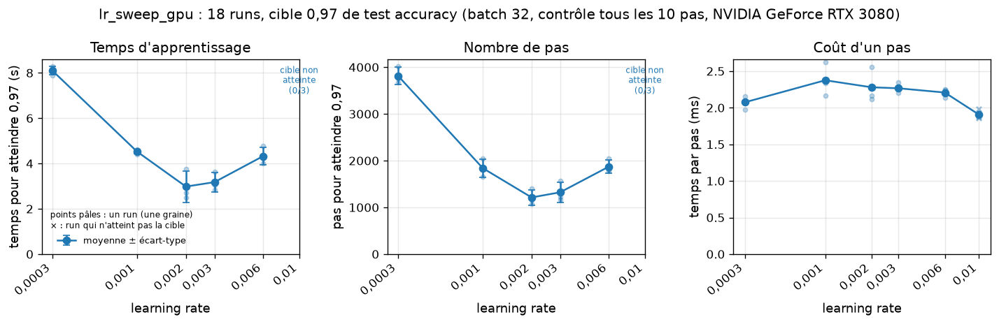
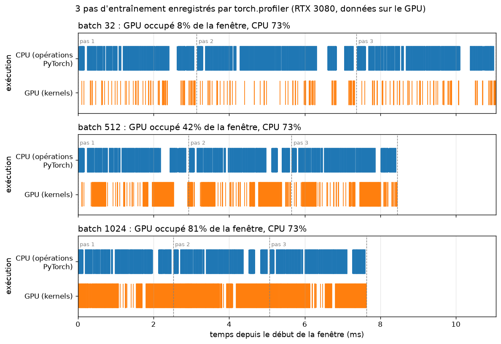
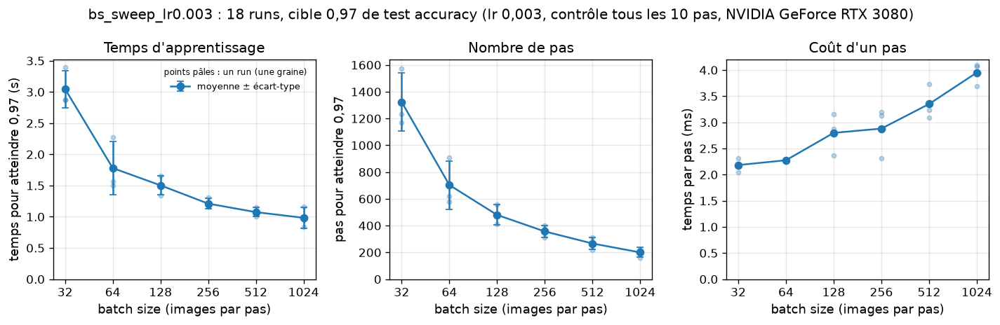
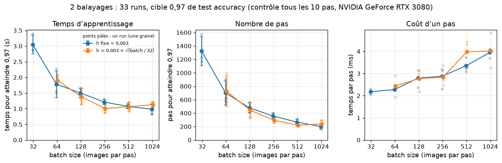
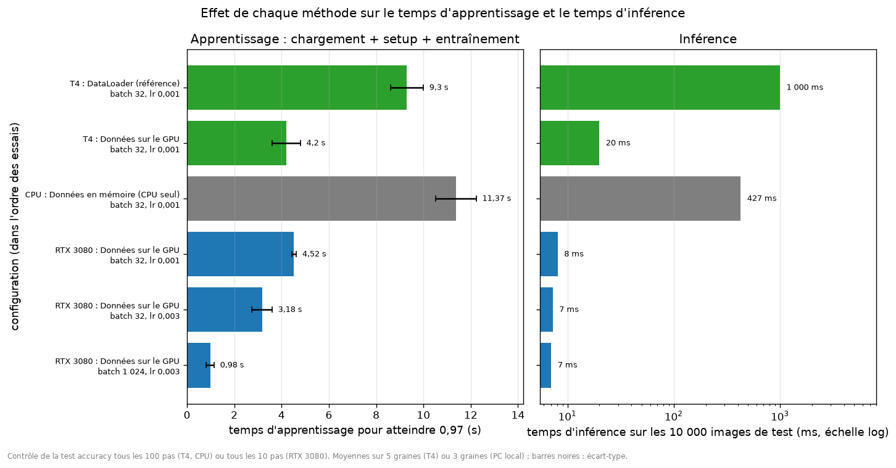
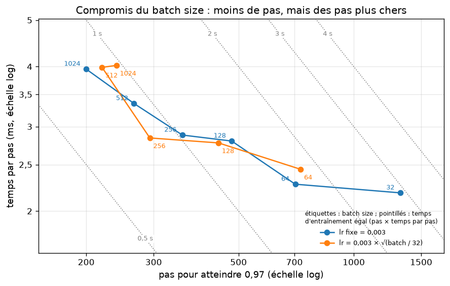

# Task 2 : MNIST, temps pour atteindre 0,97 de test accuracy

## Résumé

État au 20 novembre 2026. Réseau : CNN de la baseline du cours, optimiseur Adam, cible 0,97 de test accuracy.

| Étape | Matériel | Réglages | Temps d'apprentissage | Gain |
|---|---|---|---|---|
| Référence : images converties par le DataLoader à chaque pas | Tesla T4 (Colab) | batch 32, lr 0,001 | 9,3 s | |
| MNIST chargé une fois sur le GPU (`--data-on-device`) | Tesla T4 (Colab) | batch 32, lr 0,001 | 4,2 s | ×2,2 |
| Même réglage sur un PC local | RTX 3080 | batch 32, lr 0,001 | 4,2 s | aucun |
| Même réglage, sur le processeur seul | Ryzen 7 3800XT | batch 32, lr 0,001 | 11,4 s | |
| Contrôle tous les 10 pas, learning rate 0,003 | RTX 3080 | batch 32, lr 0,003 | 3,05 s | |
| **Batch de 1 024 images** | RTX 3080 | batch 1 024, lr 0,003 | **0,98 s** | **×3,1** (par rapport à la ligne précédente) |

Moyennes sur 5 graines (Colab) ou 3 graines (PC local). De la référence (9,3 s) au batch de 1 024 (0,98 s), le temps d'apprentissage est divisé par 9,5. Les machines diffèrent, mais à réglage égal la RTX 3080 n'est pas plus rapide que le T4.

Ce qu'on sait à ce stade :
1. **Le premier goulot était le DataLoader** : la conversion des images sur le CPU prenait 68 % d'un pas. Charger MNIST une fois sur le GPU divise le temps d'apprentissage par 2,2 (sections 3 et 4).
2. **Le learning rate change le nombre de pas, pas le coût d'un pas.** Le temps d'apprentissage dessine une courbe en U : le minimum est entre 0,002 et 0,003 (environ 3 s sur la RTX 3080) ; plus haut, il faut de nouveau plus de pas ; à 0,01, la cible n'est jamais atteinte (section 6).
3. **Une RTX 3080 ne va pas plus vite qu'un T4.** Le profiler montre pourquoi : avec des batchs de 32, le GPU ne calcule que 10 à 13 % du temps d'un pas et attend le CPU le reste du temps (section 7).
4. **Augmenter le batch size divise encore le temps par 3,1** : de 3,05 s avec 32 images par pas à 0,98 s avec 1 024. Le nombre de pas baisse bien plus vite que le coût d'un pas n'augmente (section 8).
5. **Le gain plafonne vers 1 s, et le goulot a changé de côté.** Avec 1 024 images par pas, c'est maintenant le GPU qui limite (87 % d'occupation), et environ la moitié du temps restant sont des coûts fixes : chargement des données et démarrage de l'entraînement (sections 7 et 8).
6. **Faire grandir le learning rate avec le batch size n'apporte pas de gain significatif.** La règle en racine carrée de Malladi et al. (2022), testée comme méthode tirée d'un article, donne au mieux −17 % avec 256 images par pas (p = 0,10) et +15 % avec 1 024 (section 9).

## Objectif, données, évaluation et discussion

Points demandés pour chaque tâche dans les consignes de soutenance.

### Objectif

- **Problème d'apprentissage** : classification supervisée multiclasse. L'estimateur reçoit l'image d'un chiffre manuscrit et prédit sa classe parmi 10 (de 0 à 9).
- **Estimateur** : le réseau de neurones convolutif de la baseline du cours, entraîné par descente de gradient stochastique par mini-lots (optimiseur Adam), en minimisant l'entropie croisée sur le jeu d'entraînement.
- **Ce que la tâche optimise** : pas la précision elle-même, mais le **temps d'apprentissage** nécessaire pour atteindre une **test accuracy de 0,97**, à matériel fixé. Ce temps compte le chargement des données, la création du modèle et l'optimisation, mais pas les évaluations de contrôle. Le **temps d'inférence** est suivi en parallèle.

### Entrées et sorties

- **Données** : MNIST, 70 000 images de chiffres manuscrits en niveaux de gris. Découpage standard : **60 000 images d'entraînement** et **10 000 images de test**. Les classes sont à peu près équilibrées (de 5 421 à 6 742 images par classe à l'entraînement). Les scripteurs des deux jeux sont différents.
- **Features** : **784 par image**, l'intensité des 28 × 28 pixels. Chaque chiffre est centré dans l'image, et le fond vaut 0. Les pixels sont des entiers de 0 à 255 à l'origine.
- **Prétraitement** : chaque pixel est divisé par 255 pour être ramené entre 0 et 1 (c'est ce que fait `transforms.ToTensor`), une échelle adaptée à l'initialisation des poids et au learning rate par défaut. Aucune autre transformation (pas de centrage-réduction, pas d'augmentation de données). Avec `--data-on-device`, cette conversion est faite une seule fois sur le GPU, à l'identique bit pour bit (section 4). Aucune comparaison avec et sans ce prétraitement n'a été faite.
- **Entrée du réseau** : un tenseur de forme (batch, 1, 28, 28). L'image n'est pas aplatie, pour que la convolution exploite la structure spatiale.
- **Architecture** : convolution 3 × 3 à 28 filtres → max-pooling 2 × 2 → aplatissement (28 × 13 × 13 = 4 732 valeurs) → couche dense de 128 neurones avec ReLU → dropout 0,2 → couche dense de 10 neurones. Au total, 607 394 paramètres, dont 99,7 % dans la première couche dense.
- **Sortie** : 10 scores (logits), un par chiffre. La classe prédite est celle du score le plus élevé. Le softmax est intégré à la fonction de perte (`nn.CrossEntropyLoss`).

### Évaluation

- **Score de l'estimateur : la test accuracy**, c'est-à-dire la part des 10 000 images de test correctement classées. Elle est mesurée tous les 10 pas (tous les 100 dans les sections 2 à 4 et dans la première série de la section 6), et l'entraînement s'arrête dès qu'elle atteint 0,97. Sur tous les runs qui atteignent la cible, la test accuracy à l'arrêt est comprise entre 0,970 et 0,975. Aucun score d'entraînement ni de validation n'a été mesuré.
- **Score de la tâche : le temps d'apprentissage** (en secondes), en moyenne ± écart-type sur 3 graines (PC local) ou 5 graines (Colab). Le meilleur résultat est **0,98 s ± 0,17 s** (RTX 3080, batch de 1 024, learning rate 0,003, section 8), contre 9,3 s ± 0,7 s pour la référence (section 4).
- **Temps d'inférence** sur les 10 000 images de test : environ 7 ms sur la RTX 3080 avec les données sur le GPU (0,7 µs par image), contre environ 0,4 s sur le CPU seul et 1,0 s avec le DataLoader sur le T4.

### Discussion

- **Jusqu'où le problème est-il résolu ?** L'objectif est atteint de façon fiable : tous les runs atteignent 0,97, sauf ceux dont le learning rate est trop grand (0,01). Le temps d'apprentissage passe de 9,3 s à moins de 1 s. Ce chiffre reste propre à une machine (RTX 3080, Ryzen 7 3800XT) : ce sont les gains relatifs qui se transposent, pas les secondes.
- **Le modèle est-il utilisable ?** Une précision de 0,97 signifie environ 300 erreurs sur 10 000 chiffres. C'est acceptable pour un tri avec vérification humaine, pas pour lire sans contrôle des montants sur des chèques. Le même réseau dépasse 0,99 avec un entraînement plus long (cours) : 0,97 est un seuil choisi pour comparer des vitesses, pas une qualité de production. L'inférence, elle, est assez rapide pour du temps réel, même sur CPU (environ 40 µs par image).
- **Quelle précision attendre sur des données jamais vues ?** Un peu moins de 0,97. Le jeu de test sert ici à décider quand arrêter l'entraînement : on s'arrête précisément au moment où il atteint 0,97, ce qui rend cette mesure légèrement optimiste. Le sujet autorise cet arrêt, mais pour estimer proprement la précision sur des données nouvelles, il faudrait arrêter l'entraînement sur un jeu de validation (par exemple 10 000 images prises dans les 60 000 d'entraînement) et garder le jeu de test pour une seule évaluation finale. Enfin, les chiffres de MNIST sont centrés et de taille normalisée : sur des images prises dans d'autres conditions, la précision serait plus basse.

## 1. Protocole

- Script : `task2_mnist/time_to_target.py`, réglages par défaut
- Réseau : CNN de la baseline du cours (port PyTorch), optimiseur Adam, learning rate 1e-3, batch size 32
- Cible : **0,97 de test accuracy**, vérifiée tous les 100 pas
- Temps d'apprentissage = chargement + setup + entraînement, **sans** les évaluations de contrôle
- 3 graines (0, 1, 2), dans la même session Colab

```python
!python -m task2_mnist.time_to_target --seed 0
!python -m task2_mnist.time_to_target --seed 1
!python -m task2_mnist.time_to_target --seed 2
```

### Matériel (Google Colab)
- GPU : Tesla T4
- CPU : Intel Xeon @ 2,00 GHz, 2 threads
- PyTorch : 2.14.1+cu130

## 2. Résultats par défaut (Colab, DataLoader)

| Graine | Pas pour atteindre 0,97 | Test accuracy | Temps d'apprentissage | Chargement | Setup | Entraînement | Évaluations (exclues) | Inférence | Temps par pas |
|---|---|---|---|---|---|---|---|---|---|
| 0 | 1500 | 0,9705 | 8,59 s | 0,07 s | 0,18 s | 8,35 s | 15,23 s | 0,92 s | 5,57 ms |
| 1 | 2000 | 0,9704 | 11,40 s | 0,07 s | 0,18 s | 11,15 s | 21,38 s | 0,98 s | 5,58 ms |
| 2 | 1700 | 0,9701 | 9,77 s | 0,07 s | 0,18 s | 9,52 s | 17,28 s | 1,14 s | 5,60 ms |
| **Moyenne** | **1733** | | **9,9 s** (écart-type ≈ 1,4 s) | | | | | | **≈ 5,6 ms** |

### Sortie brute

```
hardware: {'device': 'cuda', 'cpu': 'Intel(R) Xeon(R) CPU @ 2.00GHz', 'cpu_threads': 2, 'torch': '2.14.1+cu130', 'gpu': 'Tesla T4'}
target 0.97 reached after 1500 steps (test accuracy 0.9705)
learning time (load + setup + train): 8.59 s
  load: 0.07 s
  setup: 0.18 s
  train: 8.35 s
  eval: 15.23 s
  inference: 0.92 s
hardware: {'device': 'cuda', 'cpu': 'Intel(R) Xeon(R) CPU @ 2.00GHz', 'cpu_threads': 2, 'torch': '2.14.1+cu130', 'gpu': 'Tesla T4'}
target 0.97 reached after 2000 steps (test accuracy 0.9704)
learning time (load + setup + train): 11.40 s
  load: 0.07 s
  setup: 0.18 s
  train: 11.15 s
  eval: 21.38 s
  inference: 0.98 s
hardware: {'device': 'cuda', 'cpu': 'Intel(R) Xeon(R) CPU @ 2.00GHz', 'cpu_threads': 2, 'torch': '2.14.1+cu130', 'gpu': 'Tesla T4'}
target 0.97 reached after 1700 steps (test accuracy 0.9701)
learning time (load + setup + train): 9.77 s
  load: 0.07 s
  setup: 0.18 s
  train: 9.52 s
  eval: 17.28 s
  inference: 1.14 s
```

### Ce qu'on peut en conclure

1. **Les mesures sont très reproductibles, et la variation vient du nombre de pas.** Le temps par pas est quasi identique (5,6 ms) d'une graine à l'autre. Si les temps vont de 8,6 à 11,4 s, c'est parce que certaines graines atteignent 0,97 plus tôt que d'autres, pas parce que la machine est bruitée. Le temps est donc à peu près **nombre de pas × 5,6 ms**.
2. **Le chargement est maintenant à 0,07 s.** Les 3,17 s de la première exécution étaient bien le téléchargement de MNIST.
3. **Ce qui ressemble au goulot : le chargement des images sur le CPU.**
   - Les évaluations et l'inférence prennent chacune environ 1 s pour 10 000 images, soit 0,1 ms par image, ce qui est lent pour un GPU et un si petit réseau.
   - Le Xeon n'a que 2 threads et chaque image passe par une conversion CPU à chaque accès (`ToTensor` dans le DataLoader).
   - Si ce coût est du même ordre à l'entraînement, il représenterait environ 3 ms des 5,6 ms d'un pas, soit plus de la moitié. C'est une estimation à partir de l'inférence, pas une mesure.
   - Cette hypothèse est confirmée par le test ci-dessous.

## 3. Test de confirmation du goulot

Trois mesures séparées sur 300 pas (batch 32, même session T4) :
- **A** : chargement seul (le DataLoader est parcouru sans calcul)
- **B** : chargement + copie vers le GPU
- **C** : calcul seul (toujours le même batch, déjà sur le GPU)

| Étape | Temps par pas | Part du pas mesuré (5,6 ms) |
|---|---|---|
| Chargement (A) | 3,09 ms | ≈ 55 % |
| Copie CPU vers GPU (B − A) | 0,69 ms | ≈ 12 % |
| Calcul : aller, retour, Adam (C) | 1,58 ms | ≈ 28 % |
| Non expliqué | ≈ 0,24 ms | ≈ 4 % |
| **Total mesuré** | **5,6 ms** | 100 % |

- **Hypothèse confirmée** : chargement + copie font environ **68 %** d'un pas, le calcul seulement 28 %.
- Les étapes s'additionnent presque exactement (3,78 + 1,58 = 5,36 ms pour 5,6 mesurés) : le CPU et le GPU ne travaillent pas en parallèle.
- Le chargement coûte 0,097 ms par image, comme à l'inférence : c'est la même cause.
- **Prévision** : avec MNIST chargé une fois sur le GPU, un pas ne coûterait plus que le calcul (environ 1,6 à 1,8 ms), soit un gain proche de ×3. Mesuré ci-dessous : ×2,2 sur le temps d'apprentissage.

## 4. Correction : MNIST chargé sur le GPU (`--data-on-device`)

Les images sont converties une fois et gardées en tenseurs sur le GPU, et les batchs sont tirés directement dessus (même prétraitement que `ToTensor`, vérifié bit pour bit). 5 graines (0 à 4) par mode, lancées à tour de rôle dans la même session Colab (Tesla T4), réglages par défaut.

| | DataLoader | Données sur GPU | Gain |
|---|---|---|---|
| **Temps d'apprentissage** (chargement + setup + entraînement) | 9,3 s (± 0,7) | 4,2 s (± 0,6) | **×2,2** |
| Entraînement seul | 9,0 s | 3,9 s | ×2,3 |
| Temps par pas | 5,15 ms | 1,89 ms | ×2,7 |
| Pas pour atteindre 0,97 | 1760 (± 182) | 2060 (± 313) | +17 % |
| Chargement | 0,07 s | 0,29 s | |
| Inférence (10 000 images) | 1,0 s | 0,020 s | ×50 |
| Évaluations de contrôle (total par run, exclues) | 16,9 s | 0,55 s | ×31 |
| Test accuracy à l'arrêt | 0,9701 à 0,9719 | 0,9700 à 0,9718 | identique |

- **Le goulot est levé** : temps d'apprentissage divisé par 2,2, sans perte de précision (les 10 runs atteignent 0,97).
- **Un peu sous la prévision (×3)** : un pas coûte 1,89 ms au lieu de 1,6 à 1,8 ms (le tirage des batchs sur le GPU a un petit coût, non mesuré), et les runs sur GPU demandent 17 % de pas en plus. Cet écart de pas est probablement du bruit : il n'est pas significatif avec 5 graines (t de Welch ≈ 1,85).
- Le chargement passe de 0,07 à 0,29 s (conversion + transfert), compté dans le temps d'apprentissage.
- L'inférence et les évaluations de contrôle sont 50 et 31 fois plus rapides : c'est la même cause, le chargement des images.
- Les résultats sont reproductibles : les graines 0, 1 et 2 s'arrêtent aux mêmes pas que dans la session précédente.
- **Étape suivante** : balayer le learning rate (fait en section 6) puis le batch size (section 8), maintenant que le chargement ne domine plus.

## 5. Passage sur un PC local (RTX 3080)

Les mesures des sections 6 à 9 sont faites sur un PC fixe, plus puissant que la machine Colab :

| | PC local | Colab (sections 1 à 4) |
|---|---|---|
| GPU | NVIDIA GeForce RTX 3080, 10 Go (architecture Ampere) | Tesla T4 |
| CPU | AMD Ryzen 7 3800XT, 8 cœurs / 16 threads, 3,9 GHz | Intel Xeon @ 2,00 GHz, 2 threads |
| RAM | 32 Go | — |
| Système | Windows 11 | Linux |
| PyTorch | 2.15.0+cu134 (CUDA 13.4, pilote NVIDIA 621.24) | 2.14.1+cu130 |

- Le `pyproject.toml` du dépôt installe PyTorch sans GPU. Sur ce PC, une configuration `uv` locale, non versionnée, installe à la place la version CUDA 13.4 : les commandes ci-dessous y sont lancées avec `uv run --extra cu134 python …` au lieu de `uv run python …`.
- Chaque run enregistre maintenant dans `results/task2_mnist.csv`, en plus des réglages et des temps : un `tag` (option `--tag`) pour regrouper les runs d'une même expérience, le commit git du code (`git_commit`, suffixé `-dirty` si le code a été modifié), le nom commercial du CPU et la version de CUDA.

## 6. Balayage du learning rate

Un seul paramètre change : le learning rate. Le reste est fixe : MNIST chargé une fois en mémoire (`--data-on-device`), batch de 32, Adam, au plus 20 epochs, 3 graines (0, 1, 2) par valeur. Deux séries :

- **une première série** sur le CPU et sur le GPU (0,0003 ; 0,001 ; 0,003 ; 0,01), avec un contrôle tous les 100 pas. Sur le GPU, elle a été perturbée (voir les réserves) ;
- **une série GPU refaite** dans un environnement propre, avec plus de valeurs (0,0003 ; 0,001 ; 0,002 ; 0,003 ; 0,006 ; 0,01) et un contrôle tous les 10 pas, comme pour le batch size (section 8).

```powershell
# première série
foreach ($lr in 0.0003, 0.001, 0.003, 0.01) { foreach ($seed in 0, 1, 2) { uv run python -m task2_mnist.time_to_target --data-on-device --lr $lr --seed $seed } }
# série GPU refaite
foreach ($lr in 0.0003, 0.001, 0.002, 0.003, 0.006, 0.01) { foreach ($seed in 0, 1, 2) { uv run python -m task2_mnist.time_to_target --data-on-device --lr $lr --eval-every 10 --seed $seed --tag lr_sweep_gpu } }
uv run python -m task2_mnist.plot_sweep --tag lr_sweep_gpu --param learning_rate
```

### Sur le CPU (Ryzen 7 3800XT, 16 threads)

| Learning rate | Cible atteinte | Pas pour atteindre 0,97 | Temps d'apprentissage | Temps par pas | Inférence (10 000 images) |
|---|---|---|---|---|---|
| 0,0003 | 3 / 3 | 3 867 (± 351) | 22,7 s (± 2,7) | 5,9 ms | 0,40 s |
| 0,001 | 3 / 3 | 1 867 (± 208) | 11,4 s (± 0,9) | 6,1 ms | 0,43 s |
| **0,003** | 3 / 3 | **1 467** (± 58) | **8,8 s** (± 0,5) | 5,9 ms | 0,41 s |
| 0,01 | **0 / 1** | non atteint : 0,944 après 20 epochs (37 500 pas) | 199,6 s | 5,3 ms | 0,40 s |

### Sur le GPU (RTX 3080), première série : environnement perturbé

| Learning rate | Cible atteinte | Pas pour atteindre 0,97 | Temps d'apprentissage | Temps par pas | Inférence (10 000 images) |
|---|---|---|---|---|---|
| 0,0003 | 3 / 3 | 4 000 (± 100) | 7,6 s (± 0,1) | 1,8 ms | 12 ms |
| 0,001 | 3 / 3 | 1 967 (± 208) | 4,2 s (± 0,2) | 2,0 ms | 7 ms |
| 0,003 | 3 / 3 | 1 533 (± 208) | 4,3 s (± 0,4) | 2,6 ms | 7 ms |
| 0,01 | **0 / 3** | non atteint : 0,914 à 0,946 après 20 epochs | 65,6 s (± 0,9) | 1,7 ms | 12 ms |

### Sur le GPU (RTX 3080), série refaite proprement (contrôle tous les 10 pas)

| Learning rate | Cible atteinte | Pas pour atteindre 0,97 | Epochs vues | Temps d'apprentissage | Temps par pas | Inférence (10 000 images) |
|---|---|---|---|---|---|---|
| 0,0003 | 3 / 3 | 3 817 (± 182) | 2,04 | 8,10 s (± 0,20) | 2,07 ms | 7 ms |
| 0,001 | 3 / 3 | 1 840 (± 197) | 0,98 | 4,52 s (± 0,10) | 2,38 ms | 8 ms |
| **0,002** | 3 / 3 | **1 213** (± 167) | 0,65 | **2,98 s** (± 0,69) | 2,28 ms | 7 ms |
| **0,003** | 3 / 3 | 1 323 (± 216) | 0,71 | **3,18 s** (± 0,43) | 2,27 ms | 7 ms |
| 0,006 | 3 / 3 | 1 873 (± 145) | 1,00 | 4,33 s (± 0,40) | 2,21 ms | 8 ms |
| 0,01 | **0 / 3** | non atteint : 0,914 à 0,946 après 20 epochs (37 500 pas) | 20 | 70 à 74 s | 1,91 ms | — |

± : écart-type sur les 3 graines. Temps d'apprentissage : chargement + setup + entraînement, sans les évaluations de contrôle. Temps par pas : temps d'entraînement ÷ nombre de pas (calculé sur tous les runs, y compris ceux qui n'atteignent pas la cible).



### Ce qu'on peut en conclure

1. **Le learning rate change le nombre de pas, pas le coût d'un pas.** Un pas coûte environ 6 ms sur le CPU et 2,1 à 2,4 ms sur le GPU, quel que soit le learning rate. Le temps d'apprentissage suit donc le nombre de pas.
2. **Le temps d'apprentissage dessine une courbe en U : c'est un compromis entre vitesse et stabilité.**
   - Trop petit, le learning rate fait avancer l'optimisation à petits pas : 3 817 pas et 8,1 s à 0,0003.
   - Le minimum se situe entre 0,002 et 0,003 : environ 1 200 à 1 300 pas, environ 3 s sur le GPU (8,8 s sur le CPU à 0,003).
   - Plus grand, il faut de nouveau plus de pas : 1 873 pas et 4,3 s à 0,006.
   - Trop grand, la cible n'est jamais atteinte : à 0,01, la test accuracy plafonne entre 0,91 et 0,95 après 20 epochs, sur CPU comme sur GPU. Les pas d'Adam sont trop grands, et l'optimisation oscille au lieu de converger.
3. **0,002 et 0,003 ne se distinguent pas** avec 3 graines (2,98 s ± 0,69 contre 3,18 s ± 0,43). Les balayages du batch size (sections 8 et 9) utilisent 0,003, choisi avant cette série.
4. **Le GPU n'apporte qu'un facteur 2 à 3 par rapport au CPU** (×2,5 à 2,7 à lr 0,001 selon la série GPU : 11,4 s contre 4,5 ou 4,2 s). C'est peu pour une RTX 3080 : la section 7 explique pourquoi.
5. **La RTX 3080 n'est pas plus rapide que le T4** : à lr 0,001 avec les données sur le GPU, 4,2 à 4,5 s et 2,0 à 2,4 ms par pas, contre 4,2 s et 1,89 ms sur Colab (section 4). Sa puissance de calcul n'est donc pas ce qui limite.
6. **Pour une graine et un appareil donnés, les runs sont reproductibles.** À lr 0,003, les 3 graines s'arrêtent exactement aux mêmes pas que les runs du batch de 32 en section 8 (1 230, 1 570 et 1 170) ; à lr 0,01, la test accuracy finale est identique d'une série à l'autre (0,9393, 0,9460 et 0,9138). Seuls les temps varient. En revanche, **la même graine ne donne pas le même nombre de pas sur CPU et sur GPU** (lr 0,0003, graine 0 : 3 500 pas sur CPU, 4 100 sur GPU) : le tirage des batchs (`torch.randperm`) ne produit pas la même suite de nombres sur les deux appareils.

**Réserves :**
- Pendant la première série GPU, l'environnement Python était abîmé : `uv` réinstallait PyTorch (environ 10 s de copie de fichiers) juste avant chaque run. La série refaite le confirme : à lr 0,003, un pas y coûte 2,27 ms, et non 2,6 ms. L'anomalie venait de l'environnement, pas du learning rate.
- Sur CPU, lr 0,01 n'a qu'une graine : la série a été arrêtée avant les graines 1 et 2.

## 7. Profilage avec torch.profiler

### Protocole

`--profile` remplace le run « jusqu'à 0,97 » et n'écrit rien dans le CSV :
1. 1 s d'entraînement pour que le GPU monte en fréquence, puis 500 pas chronométrés **sans** profiler : c'est le vrai coût d'un pas ;
2. une trace `torch.profiler` (côté CPU et côté GPU) de 20 pas d'entraînement, après 5 pas de chauffe non gardés ;
3. la même chose pour l'inférence sur les 10 000 images de test (5 passages chronométrés, 1 enregistré) ;
4. le **taux d'occupation du GPU** : temps de calcul GPU d'un pas (mesuré par le profiler) ÷ temps d'un pas (mesuré sans profiler).

Le profiler ralentit le côté CPU : un pas dure 5,6 ms sous profiler contre 2,25 ms sans. Ses durées CPU servent à comprendre, jamais à mesurer. Les durées des calculs GPU, elles, ne sont pas modifiées.

```powershell
uv run python -m task2_mnist.time_to_target --data-on-device --batch-size 32 --profile
uv run python -m task2_mnist.time_to_target --data-on-device --batch-size 512 --profile
uv run python -m task2_mnist.time_to_target --data-on-device --batch-size 1024 --profile
uv run python -m task2_mnist.plot_profile --batch-sizes 32 512 1024
```

Les traces sont écrites dans `task2_mnist/traces/` (non versionnées) et s'ouvrent sur https://ui.perfetto.dev.

### Résultats (RTX 3080, données sur le GPU)

| | Batch 32 | Batch 512 | Batch 1 024 |
|---|---|---|---|
| Temps d'un pas, sans profiler | 2,15 à 2,96 ms (5 lancements) | 1,81 à 2,08 ms (4 lancements) | 2,37 ms (1 lancement) |
| Temps de calcul GPU par pas | 0,28 à 0,30 ms | 1,19 ms | 2,06 ms |
| **Occupation du GPU pendant un pas** | **10 à 13 %** | **57 à 66 %** | **87 %** |
| Calculs GPU (kernels) lancés par pas | 37 | 33 | 34 |
| Images traitées par pas | 32 | 512 | 1 024 |
| Débit en régime établi | 11 000 à 15 000 images/s | 250 000 à 280 000 images/s | 430 000 images/s |

Inférence (10 000 images par paquets de 2 048, même modèle) : 7,1 à 7,7 ms par passage, dont 6,5 à 6,9 ms de calcul GPU, soit **84 à 95 % d'occupation**.

### Ce que montre la trace



La figure (`task2_mnist/plot_profile.py`) reprend 3 pas des traces. En bleu, les moments où le CPU exécute une opération PyTorch ; en orange, ceux où le GPU calcule. Les pourcentages du titre sont mesurés sous profiler, qui étire le côté CPU : ils sont plus bas que les vrais taux d'occupation du tableau.

- **Batch 32 : le GPU attend presque tout le temps.** Chaque pas lance 37 petits calculs l'un après l'autre (forward, backward, Adam). Chacun dure quelques microsecondes (un produit de matrices `aten::mm` : 6 µs ; le backward de la convolution : 42 µs), moins que le temps que met Python à préparer et lancer le suivant. Les traits orange sont isolés au milieu de grands vides.
- **Batch 512 : à peu près autant de calculs, mais 16 fois plus gros.** Le temps d'un pas ne change presque pas (environ 2 ms), parce qu'il est fixé par le CPU qui lance les opérations. Le GPU, lui, est enfin occupé une bonne partie du temps.
- **Batch 1 024 : le GPU ne s'arrête presque plus.** La ligne orange est quasi continue : c'est maintenant le GPU qui fixe la durée d'un pas, et le CPU qui l'attend.
- **Le CPU travaille en continu.** Les 27 % de vide sur la ligne bleue correspondent au code Python exécuté entre deux opérations PyTorch, que le profiler n'enregistre pas ici.

### Détails tirés du tableau du profiler (batch 32)

- **Adam** occupe environ 0,5 ms de chaque pas sur la ligne du GPU (`Optimizer.step#Adam.step`), alors que ses calculs (`_foreach_addcdiv_`, `_foreach_lerp_`, `_foreach_sqrt`…) ne totalisent qu'environ 80 µs : le reste est de l'attente entre ces petites opérations. `torch.optim.Adam(..., fused=True)` les regrouperait en une seule.
- **Les convolutions tournent déjà en TF32** (`tf32` dans le nom des kernels cuDNN) : cuDNN l'active par défaut sur les GPU Ampere. Les produits de matrices des couches linéaires (`ampere_sgemm_…`), eux, sont en float32.

### Détails tirés du tableau du profiler (batch 1 024)

Sur les 2,06 ms de calcul GPU d'un pas :

| Opération | Calcul GPU par pas | Part |
|---|---|---|
| Max-pooling, aller (`max_pool2d_with_indices`) et retour (`…_backward`) | 0,62 ms | 30 % |
| Backward de la convolution (`convolution_backward`) | 0,37 ms | 18 % |
| Additions élément par élément (`aten::add_`) | 0,23 ms | 11 % |
| Pas d'Adam (`Optimizer.step#Adam.step`, durée sur la ligne du GPU) | 0,20 ms | < 10 % |

- **Le max-pooling est devenu l'opération la plus coûteuse.** Comme la convolution, il est surtout limité par la quantité de données lues et écrites en mémoire : avec 1 024 images, la sortie de la convolution pèse environ 78 Mo en float32 (1 024 × 28 canaux × 26 × 26 valeurs × 4 octets).
- **Adam ne pèse plus grand-chose** : environ 0,2 ms par pas, contre 0,5 ms sur un pas de 2 ms avec un batch de 32.

### Conclusions

1. **Avec des batchs de 32, l'entraînement est limité par le CPU, pas par le GPU** : le GPU calcule 10 à 13 % du temps. C'est pour cela qu'une RTX 3080 ne fait pas mieux qu'un T4 : sur les deux machines, c'est le lancement des opérations depuis Python qui fixe la durée d'un pas.
2. **Un pas de 512 images coûte à peu près autant qu'un pas de 32** : augmenter le batch size devrait réduire fortement le nombre de pas sans allonger chaque pas. Confirmé en section 8 : le temps d'apprentissage est divisé par 3,1 de 32 à 1 024 images par pas.
3. **L'inférence, elle, est limitée par le GPU** (84 à 95 % d'occupation) : pour l'accélérer, il faut réduire le calcul lui-même (précision réduite, modèle plus petit), pas le nombre d'opérations.
4. **Le temps d'un pas varie d'un lancement à l'autre** (2,15 à 2,96 ms pour le batch 32) : comme le CPU est le facteur limitant, toute application ouverte en arrière-plan ralentit l'entraînement. Il faut fermer les applications lourdes et répéter les mesures.
5. **Avec 1 024 images par pas, le goulot change de côté : c'est le GPU qui limite** (87 % d'occupation). De 512 à 1 024 images, son calcul par pas double presque (1,19 → 2,06 ms) : un batch encore plus gros allongerait chaque pas d'autant, sans faire gagner de temps. Pour aller plus vite, il faut alors réduire le calcul lui-même (précision réduite, max-pooling moins coûteux).

## 8. Balayage du batch size

Un seul paramètre change : le batch size (32, 64, 128, 256, 512 et 1 024 images par pas). Le reste est fixe : learning rate 0,003 (le meilleur de la section 6), MNIST chargé sur le GPU, Adam, au plus 20 epochs. 3 graines (0, 1, 2) par valeur, sur la RTX 3080, après un run à blanc non enregistré : le premier run sur un GPU « froid » a pris 6,09 s, contre environ 4,4 s pour le même réglage la veille.

La test accuracy est contrôlée **tous les 10 pas** (`--eval-every 10`), pour toutes les valeurs. Avec un batch de 1 024, une epoch ne fait que 59 pas et la cible est atteinte en environ 200 pas : un contrôle tous les 100 pas pourrait prolonger l'entraînement jusqu'à 99 pas après la cible. Ces contrôles sont exclus du temps d'apprentissage.

```powershell
foreach ($bs in 32, 64, 128, 256, 512, 1024) { foreach ($seed in 0, 1, 2) { uv run python -m task2_mnist.time_to_target --data-on-device --lr 0.003 --batch-size $bs --eval-every 10 --seed $seed --tag bs_sweep_lr0.003 } }
uv run python -m task2_mnist.plot_sweep --tag bs_sweep_lr0.003
```

| Batch size | Cible atteinte | Pas pour atteindre 0,97 | Epochs vues | **Temps d'apprentissage** | Temps par pas | Chargement |
|---|---|---|---|---|---|---|
| 32 | 3 / 3 | 1 323 (± 216) | 0,71 | 3,05 s (± 0,30) | 2,18 ms | 0,17 s |
| 64 | 3 / 3 | 703 (± 180) | 0,75 | 1,78 s (± 0,43) | 2,28 ms | 0,17 s |
| 128 | 3 / 3 | 480 (± 76) | 1,02 | 1,50 s (± 0,16) | 2,80 ms | 0,17 s |
| 256 | 3 / 3 | 357 (± 45) | 1,52 | 1,21 s (± 0,09) | 2,88 ms | 0,19 s |
| 512 | 3 / 3 | 267 (± 45) | 2,28 | 1,07 s (± 0,07) | 3,35 ms | 0,19 s |
| **1 024** | 3 / 3 | **200** (± 36) | 3,41 | **0,98 s** (± 0,17) | 3,95 ms | 0,19 s |

± : écart-type sur les 3 graines. Epochs vues : pas × batch size ÷ 60 000 images d'entraînement. L'inférence ne change pas (environ 7 ms pour les 10 000 images de test) : elle traite toujours les images par paquets de 2 048, quel que soit le batch size d'entraînement.



### Ce qu'on peut en conclure

1. **Passer de 32 à 1 024 images par pas divise le temps d'apprentissage par 3,1** (3,05 s → 0,98 s), sans perte de précision : les 18 runs atteignent 0,97.
2. **Le gain vient du nombre de pas.** Il est divisé par 6,6 (1 323 → 200), alors que le coût d'un pas n'est multiplié que par 1,8 (2,18 → 3,95 ms). C'est ce que le profiler annonçait (section 7) : avec de petits batchs, un pas coûte surtout le lancement des opérations, pas le calcul.
3. **Chaque image « sert » moins avec de gros batchs** : il faut 3,4 epochs avec un batch de 1 024, contre 0,7 avec 32. Le modèle fait moins de mises à jour de ses poids, chacune moyennée sur plus d'images : il doit donc voir plus de données. Comme chaque pas coûte peu, c'est quand même rentable.
4. **Le gain plafonne vers 1 s.** Entre 512 et 1 024 (1,07 s contre 0,98 s), l'écart est plus petit que les écarts-types : il n'est pas significatif avec 3 graines.
5. **Les coûts fixes deviennent visibles** : le chargement (0,17 à 0,19 s) représente maintenant près de 20 % d'un run d'environ 1 s.
6. **Le coût d'un pas mesuré dans ces runs augmente plus que prévu** (2,2 → 4,0 ms), alors que le profiler mesurait 1,8 à 2,1 ms pour un pas de 512 images. Le profilage du batch de 1 024 (section 7) confirme les deux explications envisagées :
   - **le GPU devient la limite** : avec 1 024 images par pas, il calcule 87 % du temps d'un pas (2,06 ms sur 2,37 ms). C'est ce qui crée le plateau : au-delà, un batch plus gros allongerait chaque pas d'autant ;
   - **les coûts de démarrage pèsent sur des runs d'environ 1 s** : en régime établi (après 1 s de chauffe), un pas de 1 024 images coûte 2,37 ms, contre 3,95 ms en moyenne dans ces runs. Sur 200 pas, l'écart représente environ 0,3 s par run, perdues au tout début de l'entraînement : premier usage des bibliothèques CUDA, choix des algorithmes de convolution, montée en fréquence du GPU.

**Où partent les 0,98 s du run le plus rapide** (batch de 1 024, moyennes des 3 graines) :

| Poste | Durée | Part |
|---|---|---|
| Chargement de MNIST sur le GPU | 0,19 s | 19 % |
| Création du modèle | 0,01 s | 1 % |
| Coûts de démarrage de l'entraînement (estimés) | ≈ 0,32 s | 33 % |
| 200 pas en régime établi (200 × 2,37 ms) | ≈ 0,47 s | 48 % |
| **Total mesuré** | **0,98 s** | |

Les coûts de démarrage sont estimés par différence : temps d'entraînement mesuré (0,79 s) moins 200 pas au coût du régime établi. **Environ la moitié du temps n'est donc plus de l'entraînement proprement dit, mais des coûts fixes.**

**Réserve :** le temps du batch de 32 (3,05 s) n'est pas directement comparable à celui de la section 6 pour le même learning rate (4,3 s) : le contrôle s'y faisait tous les 100 pas et l'environnement était perturbé.

## 9. Learning rate qui grandit avec le batch size (méthode tirée d'un article)

### Motivation

Avec un learning rate fixe, les gros batchs doivent voir plus de données : 3,4 epochs avec un batch de 1 024, contre 0,7 avec 32 (section 8). Un learning rate plus grand pour les gros batchs devrait compenser et réduire le nombre de pas.

- La règle linéaire de Goyal et al. (*Accurate, Large Minibatch SGD*, 2017) multiplie le learning rate par le même facteur que le batch size. Elle est faite pour SGD : elle donnerait environ 0,1 pour un batch de 1 024, alors qu'avec Adam 0,01 échoue déjà avec un batch de 32 (section 6).
- Pour Adam, Malladi et al. (*On the SDEs and Scaling Rules for Adaptive Gradient Algorithms*, 2022) proposent une **règle en racine carrée** : lr = 0,003 × √(batch ÷ 32). C'est elle qui est testée ici.

### Protocole

Même protocole qu'en section 8 (MNIST sur le GPU, contrôle tous les 10 pas, 3 graines, RTX 3080) ; seul le learning rate change avec le batch size. Le batch de 32 n'est pas relancé : la règle y donne lr = 0,003, déjà mesuré en section 8.

```powershell
foreach ($bs in 64, 128, 256, 512, 1024) { $lr = [math]::Round(0.003 * [math]::Sqrt($bs / 32), 5); foreach ($seed in 0, 1, 2) { uv run python -m task2_mnist.time_to_target --data-on-device --lr $lr --batch-size $bs --eval-every 10 --seed $seed --tag bs_sweep_sqrt_lr } }
uv run python -m task2_mnist.plot_sweep --tag bs_sweep_lr0.003 bs_sweep_sqrt_lr --labels "lr fixe = 0,003" "lr = 0,003 × √(batch / 32)"
```

### Résultats

Les 15 runs atteignent 0,97.

| Batch size | lr (racine carrée) | Pas : lr fixe → racine carrée | Epochs vues | **Temps : lr fixe → racine carrée** | Écart | p (test de Welch) |
|---|---|---|---|---|---|---|
| 64 | 0,0042 | 703 → 727 (± 229) | 0,75 → 0,78 | 1,78 s → 1,91 s (± 0,16) | +7 % | 0,67 |
| 128 | 0,006 | 480 → 443 (± 107) | 1,02 → 0,95 | 1,50 s → 1,38 s (± 0,26) | −8 % | 0,53 |
| 256 | 0,0085 | 357 → 293 (± 42) | 1,52 → 1,25 | 1,21 s → **1,01 s** (± 0,13) | **−17 %** | 0,10 |
| 512 | 0,012 | 267 → 220 (± 10) | 2,28 → 1,88 | 1,07 s → 1,07 s (± 0,14) | −1 % | 0,93 |
| 1 024 | 0,017 | 200 → 240 (± 52) | 3,41 → 4,10 | 0,98 s → 1,13 s (± 0,10) | +15 % | 0,28 |

± : écart-type sur les 3 graines de la règle en racine carrée (ceux du learning rate fixe sont en section 8). p : probabilité d'observer un écart au moins aussi grand par hasard ; en dessous de 0,05, on considère généralement l'écart comme réel.



### Ce qu'on peut en conclure

1. **La règle en racine carrée n'apporte pas de gain significatif.** Aucun écart n'est significatif avec 3 graines. La seule tendance est avec 256 images par pas : −17 % (1,21 → 1,01 s), avec moins de pas (357 → 293), mais p = 0,10.
2. **Avec 1 024 images par pas, elle fait même légèrement pire** : 240 pas au lieu de 200, et 4,1 epochs au lieu de 3,4. Un learning rate de 0,017 est sans doute trop grand pour Adam sur ce réseau.
3. **Pourquoi la règle ne marche pas ici (hypothèse).** Elle vise à garder le même nombre d'epochs quand le batch grossit, dans un régime où le bruit du gradient domine. Or ici, la cible est atteinte en moins d'une epoch avec un batch de 32, tout au début de l'entraînement. Ce qui limite alors, c'est plutôt la stabilité : un learning rate plus grand fait vite osciller l'optimisation. Avec un batch de 32, il faut déjà plus de pas à 0,006 qu'à 0,003, et 0,01 échoue (section 6).
4. **Le coût d'un pas est bruité sur des runs aussi courts.** Avec 512 images par pas, la règle fait gagner 47 pas mais le temps ne change pas : le pas a coûté 3,99 ms au lieu de 3,35 ms, pour le même calcul. L'écart vient de la machine, pas de la méthode.
5. **Le plancher vers 1 s ne vient plus du nombre de pas.** Avec 200 à 300 pas, il reste environ 0,19 s de chargement, environ 0,3 s de démarrage, et 200 à 300 pas de 2,4 ms en régime établi (section 8). Pour descendre sous 1 s, il faut réduire le coût de chaque pas et les coûts fixes, plus le nombre de pas.

C'est un essai négatif, mais il répond à l'exigence du sujet : une méthode tirée d'un article a été testée, mesurée et discutée.

## 10. Synthèse : compromis et effet de chaque méthode

```powershell
uv run python -m task2_mnist.plot_tradeoffs
```

### Effet de chaque méthode sur l'apprentissage et sur l'inférence



| Méthode | Effet sur le temps d'apprentissage | Effet sur le temps d'inférence |
|---|---|---|
| MNIST chargé une fois sur le GPU, au lieu du DataLoader (T4) | ×2,2 (9,3 → 4,2 s) | **×50** (1 000 → 20 ms) |
| GPU au lieu du CPU seul (lr 0,001) | ×2,5 (11,4 → 4,5 s) | **×50** environ (427 → 8 ms) |
| Learning rate 0,003 au lieu de 0,001 (RTX 3080) | ×1,4 (4,5 → 3,2 s) | aucun (7 à 8 ms) |
| Batch de 1 024 au lieu de 32 (RTX 3080) | ×3,1 (3,05 → 0,98 s) | aucun (7 ms) |

- **Les méthodes qui changent le chemin des données ou le matériel agissent sur les deux temps**, et bien plus sur l'inférence : charger MNIST sur le GPU, ou utiliser le GPU plutôt que le CPU, accélère l'inférence d'un facteur 50 environ.
- **Les hyperparamètres d'entraînement (learning rate, batch size) n'agissent que sur l'apprentissage** : ils changent le nombre de pas pour atteindre 0,97, pas le réseau obtenu. L'inférence, qui traite toujours les images par paquets de 2 048 avec la même architecture, reste à environ 7 ms.
- **Les gains d'apprentissage se cumulent** : de 9,3 s à 0,98 s, soit un facteur 9,5.

### Le compromis du batch size



Chaque point est un batch size, placé selon le nombre de pas pour atteindre 0,97 (horizontalement) et le coût d'un pas (verticalement), les deux en échelle logarithmique. Les pointillés relient les points de même temps d'entraînement (nombre de pas × coût d'un pas, sans le chargement) : plus un point est bas à gauche, plus l'entraînement est court.

- **De 32 à 1 024 images par pas, les points partent vers la gauche** (6,6 fois moins de pas) **et montent** (des pas 1,8 fois plus chers). Comme ils vont bien plus vite à gauche qu'en haut, ils traversent les lignes de temps égal : le temps d'entraînement passe d'environ 2,9 s à 0,8 s.
- **La courbe se redresse vers la pente des pointillés** : entre 32 et 64 images, elle est presque horizontale (gros gain) ; entre 512 et 1 024, doubler le batch ne fait plus gagner qu'environ 10 % (0,88 → 0,79 s). C'est le plateau de la section 8, et la raison pour laquelle un batch encore plus gros n'apporterait plus rien.
- **La règle en racine carrée (en orange)** décale certains points vers la gauche (moins de pas avec 256 et 512 images), mais pas celui de 1 024 : c'est le résultat de la section 9.

Le compromis du learning rate, entre vitesse et stabilité, est montré par la courbe en U de la section 6.

## 11. Prochaines étapes

Configuration de référence pour la suite : batch de 1 024, learning rate 0,003 (0,98 s, section 8). Avec ce batch, le GPU est la limite (87 % d'occupation, section 7) et environ la moitié du temps sont des coûts fixes (section 8). Un seul changement à la fois, 3 graines et un `--tag` par série.

1. **Réduire la précision** : float16 avec `torch.autocast` (Micikevicius et al., *Mixed Precision Training*, 2018). C'est le levier le plus prometteur maintenant que le GPU est la limite : le max-pooling et la convolution sont limités par la quantité de données déplacées en mémoire, et le float16 la divise par deux. Effet attendu aussi sur l'inférence.
2. **Réduire les coûts fixes** (environ 0,5 s sur 0,98 s) : le chargement de MNIST (0,19 s) et le démarrage de l'entraînement (environ 0,3 s).
3. **Alléger le max-pooling**, l'opération la plus coûteuse (30 % du calcul GPU) : par exemple une convolution à pas de 2 à sa place, ou moins de filtres. Le modèle change : il faut vérifier le nombre de pas autant que le coût d'un pas.
4. **`Adam(fused=True)`** : gain limité avec un batch de 1 024 (Adam pèse moins de 10 % du pas), plus intéressant avec 32 ; puis `torch.compile` si Triton fonctionne sous Windows (sinon sur Colab).
5. **Mesurer la précision sur des données nouvelles sans biais** : arrêter l'entraînement sur un jeu de validation pris dans les 60 000 images d'entraînement, et garder le jeu de test pour une seule évaluation finale (voir la discussion en tête du rapport).

Augmenter encore le batch size n'a plus d'intérêt : le GPU est presque saturé, et un batch plus gros allongerait chaque pas d'autant.
