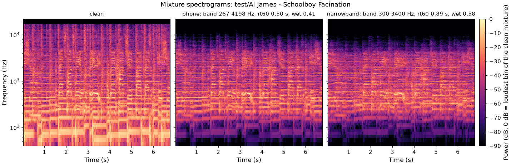

# Task 3 · Ultimate Vocal Remover (UVR)

## Installation

1. Clone UVR at tag v5.6 **outside this repository**:

   ```bash
   git clone --branch v5.6 --depth 1 https://github.com/Anjok07/ultimatevocalremovergui.git
   ```

2. Install the system dependencies. On Fedora, check which ffmpeg package is
   installed (`ffmpeg` from RPM Fusion or `ffmpeg-free` from Fedora):

   ```bash
   rpm -q ffmpeg ffmpeg-free
   ```

   Install one of them if neither is present.

3. Deactivate this repository's virtual environment, otherwise `uv` warns
   about `VIRTUAL_ENV`:

   ```bash
   deactivate
   ```

4. Copy the three files from `task3_uvr/uvr_env/` (`pyproject.toml`,
   `uv.lock`, `.python-version`) to the UVR root, then install and launch from
   there:

   ```bash
   cp task3_uvr/uvr_env/{pyproject.toml,uv.lock,.python-version} /path/to/ultimatevocalremovergui/
   cd /path/to/ultimatevocalremovergui
   uv sync
   uv run UVR.py
   ```

5. If UVR crashes at startup, apply the Wayland fix from
   [Known issues](#known-issues).

6. Download **UVR-MDX-NET Inst HQ 3** from the GUI download center.

7. For the benchmark model, copy the course's `project/uvr_my_models` folder
   to the UVR root, then run `1_create_benchmark_model.py`.

## Setup

- UVR v5.6 is cloned **outside this repository** and is not versioned here.
  It has its own `uv` environment on Python 3.10.
- Models go in `models/MDX_Net_Models/` at the UVR root:

  | Model | Source | Notes |
  | --- | --- | --- |
  | `UVR-MDX-NET-Inst_HQ_3.onnx` | GUI download center | Primary stem is **Instrumental** |
  | `Benchmark_CentreChannel.onnx` | Created by the course's `1_create_benchmark_model.py` | Use **Segment Size 256** |

- HQ 3's primary stem is the instrumental: the GUI shows
  "Instrumental Only / Vocals Only". Fine-tuning must therefore target the
  accompaniment, not the vocals.
- UVR names outputs after the input file, so running a second model
  overwrites the first model's stems. Enable
  **Settings > Additional Settings > Model Test Mode** to keep the model name
  in the output file names.

## Known issues

### Crash at startup on Fedora under Wayland

UVR crashes at startup with:

```
[xcb] Extra reply data still left in queue
```

The cause is the bundled `tkinterdnd2` drag-and-drop library. Plain Tk,
pyglet fonts and `screeninfo` work.

Fix: in `UVR.py`, line 83, set

```python
is_dnd_compatible = False
```

Drag and drop is then disabled; choose files with the **Select Input** and
**Select Output** buttons.

## Verification

Run on 2026-11-12, CPU only (Intel Core i7-1165G7, no CUDA), on the
7-second musdb7 test clip "Al James - Schoolboy Facination":

| Model | Time | Output stems |
| --- | --- | --- |
| UVR-MDX-NET Inst HQ 3 | 10 s | Vocals, Instrumental |
| Benchmark_CentreChannel (Segment Size 256) | < 1 s | Vocals, Instrumental |

## HQ 3 in PyTorch (T3-05)

Checks that HQ 3 can be converted with onnx2pytorch, trained for one step and
re-exported to a file UVR's onnxruntime 1.13.1 loads. The original model is
only read; its MD5 is checked before and after. Run from the repository root
(`<UVR>` is the UVR clone):

```bash
M=<UVR>/models/MDX_Net_Models/UVR-MDX-NET-Inst_HQ_3.onnx

# Steps 1-6, this repository's environment
uv run python -m task3_uvr.hq3_trainable check --model "$M"

# Load the re-exported model in UVR's environment (onnxruntime 1.13.1)
uv run --project <UVR> --no-sync python -m task3_uvr.check_onnxruntime_113 --model "$M"

# Copy it to UVR as HQ3_T3-05_step1.onnx and write its settings JSON
uv run python -m task3_uvr.hq3_trainable install --model "$M"
```

The re-exported model and its input/output go to `task3_uvr/artifacts/`
(not versioned). Results and exact library versions are in
`results/task3_hq3_trainable.json`.

### Results

Run on 2026-11-12, CPU only (Intel Core i7-1165G7, 4 torch threads), torch
2.15.0, onnx 1.23.2, onnx2pytorch 0.6.0, onnxruntime 1.31.1 (and 1.13.1 for
the UVR check). The input is one random-noise spectrogram of shape
`[1, 4, 3072, 256]`, not real audio. "Identical" means the max absolute
difference is below 1e-4 times the largest absolute output (9.12).

| Step | Result |
| --- | --- |
| 1. Graph | Opset 13, IR 6, exported by PyTorch 1.9. 16,684,228 values in 220 initializers, of which 8,352 are BatchNorm running statistics. Operators: Relu 66, Conv 40, BatchNormalization 27, MatMul 22, Add 11, ConvTranspose 5, Mul 5, Transpose 2 |
| 2. Conversion | No error. 166 trainable tensors, 16,675,876 values: every weight except the BatchNorm statistics |
| 3. Parity, onnxruntime vs PyTorch | Max abs diff 8.0e-5 (relative 8.8e-6): identical |
| 4. Gradient step (L1 loss, Adam, lr 1e-5) | All 166 tensors get a non-zero gradient; all 166 change after the step |
| 5. Re-export (opset 17, IR 8) | 166 of 220 initializers differ from the original (the 54 BatchNorm statistics do not). PyTorch vs onnxruntime 1.31: max abs diff 7.0e-5 (relative 7.7e-6). onnxruntime 1.13.1 loads it: max abs diff 7.7e-5 (relative 8.5e-6) |
| 6. UVR settings | Hash `55657dd70583b0fedfba5f67df11d711`: compensate 1.022, dim_f 3072, dim_t 8 (256 frames), n_fft 6144, primary stem Instrumental |

The whole check takes about 40 s, with a peak memory of 6.7 GB (the backward
pass on one full-size spectrogram takes 13 s). The re-exported model is
installed in UVR as `HQ3_T3-05_step1.onnx`, hash
`fac837f566082189e25ab946a13e6d27`, with HQ 3's settings.

### Notes for fine-tuning (T3-10)

- **Keep BatchNorm in eval mode.** In train mode the output on the same input
  changes by 2.6 times the largest output value, because BatchNorm uses the
  batch's statistics instead of HQ 3's running averages.
- **Ignore the `_initializer_*` buffers.** onnx2pytorch keeps a copy of every
  original initializer as a buffer (16.7 M values). The forward pass uses the
  parameters; the export check confirms the updated weights are exported.
- **Export with opset 17 and the legacy exporter** (`dynamo=False`).
  onnxruntime 1.13.1 supports at most opset 17 and IR version 8. The legacy
  exporter is deprecated since PyTorch 2.9, so check it still exists in the
  Colab version, and rerun `check_onnxruntime_113` on every exported model.
- **One step moves the output a lot.** On the noise input, one Adam step at
  lr 1e-5 changed the output by up to 35% of its largest value. Use a small
  learning rate.
- **Give every fine-tuned model a new file name.** Its hash changes, so it
  needs its own `model_data/<hash>.json` with HQ 3's settings, and UVR
  caches hashes by file path until it restarts.

## Data (T3-03)

MUSDB18-7 is a free preview of MUSDB18 with one short excerpt per song. The
course's `0_download_data.py` downloads it and converts it to WAV **outside
this repository**, in the course project's `uvr_my_models/data/musdb7/`:

```
musdb7/
  train/<artist> - <title>/{mixture,vocals,accompaniment}.wav   94 clips
  test/<artist> - <title>/{mixture,vocals,accompaniment}.wav    50 clips
```

The course script builds `accompaniment.wav` as `mixture - vocals`. No audio
is versioned. The degraded copies (`musdb7_phone/`, `musdb7_narrowband/`)
are covered in [Degraded data (T3-06)](#degraded-data-t3-06).

### Check

Give the `musdb7` folder as an argument, or set `ML_TEK5_MUSDB7_DIR`:

```bash
export ML_TEK5_MUSDB7_DIR=<course project>/2_3_uvr/uvr_my_models/data/musdb7
uv run python -m task3_uvr.check_data
```

For every clip it checks that the three files exist, are 44100 Hz stereo and
have the same length. It reports the duration. It checks that
`mixture - vocals - accompaniment` stays within WAV rounding: a max absolute
residual of 1e-3 or less, and a residual energy of at most -60 dB relative to
the mixture. The audio is only read. The summary goes to
`results/task3_data_check.json`, and the exit code is 1 on any anomaly.

Results on 2026-11-13:

| Split | Clips | Artists | Format | Duration per clip | Max abs residual | Anomalies |
| --- | --- | --- | --- | --- | --- | --- |
| train | 94 | 66 | 44100 Hz, stereo, 16-bit PCM | 6.803 s (300,032 samples) | 0 | none |
| test | 50 | 45 | 44100 Hz, stereo, 16-bit PCM | 6.803 s (300,032 samples) | 0 | none |

- The clips last 6.803 s, not the 7 s the dataset name suggests.
- The residual is exactly 0: subtracting two 16-bit signals gives a value
  that 16-bit PCM stores exactly, and no accompaniment sample was clipped.
- 4 training mixtures reach 16-bit full scale and are probably clipped in the
  source: Giselle - Moss, Jay Menon - Through My Eyes, Music Delta - Beatles
  and The Districts - Vermont. They are kept.

### Artists in both the official training and test sets

The official split does not separate artists. 4 artists have clips in both
training and test sets:

| Artist | Train | Test |
| --- | --- | --- |
| Hollow Ground | Left Blind | Ill Fate |
| Skelpolu | Human Mistakes, Together Alone | Resurrection |
| The Long Wait | Back Home To Blue | Dark Horses |
| Triviul | Angelsaint, Dorothy | Widow (as "Triviul feat. The Fiend") |

The official test set is left unchanged. Test scores may be slightly
optimistic for these 4 artists (5 of the 50 test clips).

### Validation split

The validation set is taken from the official **training** clips only. The
test set is never used for tuning.

```bash
uv run python -m task3_uvr.make_split            # --seed 0 --fraction 0.15
```

The script runs the data check again and writes nothing if any clip fails.
It groups clips by artist: the folder name before `" - "`, with `feat.` guests
and a trailing `(...)` removed, so `Triviul feat. The Fiend` counts as
`Triviul`. It sorts the artists and shuffles them with
`numpy.random.default_rng(0)`. It then adds whole artists, in that order,
while the validation set stays at or below `round(0.15 × 94) = 14` clips.
No artist is in both the training and validation lists.

| List | File | Clips | Artists |
| --- | --- | --- | --- |
| Training | `task3_uvr/splits/train.json` | 80 | 56 |
| Validation | `task3_uvr/splits/validation.json` | 14 (14.9%) | 10 |
| Test (official, unchanged) | `musdb7/test/` | 50 | 45 |

Two of the validation artists, Skelpolu and The Long Wait, also have clips in
the official test set.

## SDR evaluation (T3-04)

`task3_uvr/evaluate.py` measures the SDR of MDX-Net ONNX models on
MUSDB18-7 without the GUI. The issue calls the script `4_evaluate.py`;
`python -m` needs a valid module name, hence `evaluate.py`.

```bash
export ML_TEK5_MUSDB7_DIR=<course project>/2_3_uvr/uvr_my_models/data/musdb7
export ML_TEK5_UVR_DIR=<UVR>    # only read: models and model_data

uv run python -m task3_uvr.evaluate \
    --models UVR-MDX-NET-Inst_HQ_3 Benchmark_CentreChannel \
    --splits validation test
```

- `--models` takes ONNX paths, or names in `<UVR>/models/MDX_Net_Models/`.
- The mixture reference is always added, unless `--no-mixture` is given.
- Validation uses `task3_uvr/splits/validation.json`; test uses every clip in
  `musdb7/test/`.
- Per-clip rows go to `results/task3_sdr_clips.csv`: model, hash, split,
  clip, stem, SDR, reference energy, separation time. Median and mean SDR per
  model, split and stem go to `results/task3_uvr.csv`.

**Use the validation split for model selection, early stopping and any
other tuning. The test scores are for final reporting only.**

### Inference: a port of UVR v5.6

`task3_uvr/mdx_inference.py` ports `SeperateMDX` (`separate.py`) and the
STFT of `lib_v5/tfc_tdf_v3.py`. It runs in this repository's environment:
onnxruntime 1.31.1 and torch 2.15 CPU, not UVR's 1.13.1.

- **Settings** are read from the model's hash, as UVR does: the MD5 of the
  file's last 10 MB, looked up in `model_data/<hash>.json`, then in
  `model_data.json`.
- **STFT**: hop 1024, periodic Hann window, `center=True`. Only the first
  `dim_f` bins go to the model, and bins 0–2 are zeroed. The inverse
  STFT puts the missing bins back as zeros.
- **Chunking**: `n_fft/2` zeros are added at the start, and zeros at the end
  up to whole chunks. A chunk is `1024 × (segment − 1)` samples. With
  overlap "Default" the step is `chunk − n_fft`, and chunks are cross-faded
  with a Hann window and a divider. The result is trimmed and cut to the
  input length. A 6.8 s clip takes 3 chunks.
- **Stems**: primary = model output × `compensate`; secondary = mixture −
  primary. CSV rows always use "vocals" and "accompaniment", whatever the
  model's primary stem (Instrumental for HQ 3, Vocals for the benchmark).
- **Supported settings**: segment size = `dim_t` (UVR then uses
  onnxruntime), overlap Default, batch size 1, no denoise, no pitch shift,
  no secondary model. Other settings raise an error. `margin` and `chunks`
  are assigned by UVR v5.6 but never read by `SeperateMDX.demix`.
- **Match Freq Cut** (`--match-freq-cut`, off by default): the secondary
  stem becomes the mixture sent through the STFT round trip without the
  model (overlap 0.02, no compensate) minus the primary stem. This removes
  the mixture's content below about 21 Hz from the secondary stem. On Al
  James that is −31 dB of the mixture's energy, mostly a DC offset of
  −0.0013. The reference GUI run had this option off (see below), so this
  path is **not checked against GUI output**. UVR's `data.pkl` showed it as
  on, but it was saved on 2026-11-12, before the 2026-11-13 reference run.

### SDR definition

The global SDR of the Music Demixing Challenge, per stem and clip:

    SDR = 10 log10((Σ s² + ε) / (Σ (s − ŝ)² + ε)),   ε = 1e-7

The sums run over both channels and all samples. A perfect estimate gives
about 10 log10(Σ s² / 1e-7) instead of infinity, and a silent stem with a
silent estimate gives 0 dB. Reasons for this choice:

- museval's SDR is the median over 1 s frames, so a 6.8 s clip would give
  only about 7 values.
- museval drops frames where the reference is silent, which vocals often
  are. The global SDR is always defined.
- It is cheap and has no dependencies.

The CSV's `reference_energy` column flags clips with almost silent vocals,
where the vocal SDR means little. The **mixture reference** uses the
mixture as the estimate of both stems. It gives the score of doing nothing,
so a model is only useful above it.

### Comparison with the GUI

`task3_uvr/compare_gui.py` runs the pipeline on the GUI's input and compares
the outputs. The reference run is HQ 3 on the test clip "Al James -
Schoolboy Facination", with Segment Size 256, Overlap Default, CPU, 16-bit
PCM output and no normalization:

```bash
uv run python -m task3_uvr.compare_gui --gui-dir <folder with the GUI's WAVs>
```

Results are in `results/task3_gui_compare.json`. The clip has 300,032 × 2 =
600,064 samples per stem.

| Stem | Max abs diff, float output | Samples differing after 16-bit conversion | SDR vs GUI (16-bit) | SDR vs ground truth, GUI / pipeline |
| --- | --- | --- | --- | --- |
| Accompaniment (primary) | 3.07e-5 (1.0 LSB) | 693, by 1 LSB | 97.4 dB | 11.564 / 11.564 dB |
| Vocals (secondary) | 3.06e-5 (1.0 LSB) | 687, by 1 LSB | 96.3 dB | 10.447 / 10.447 dB |

The pipeline reproduces the GUI. The GUI writes 16-bit PCM, so a float
output differs from it by up to half an LSB, 1.5e-5. Once written as 16-bit
PCM the same way UVR does (`soundfile`, `PCM_16`), 99.9% of samples are
identical. The others are off by one LSB (3.05e-5). Floating-point
differences between onnxruntime 1.31.1 + torch 2.15 and UVR's onnxruntime
1.13.1 put those samples on the other side of a rounding boundary; T3-05
measured those runtime differences at about 1e-5 on this model. No sample
is above full scale, so clipping plays no part.

With Match Freq Cut on, the vocals differ from the GUI by up to 1.1e-2
(28 dB SDR against the GUI), which shows that the GUI run had it off.
Its SDR against the ground truth is 10.508 dB instead of 10.447 dB.

### Results

Run on 2026-11-13, CPU only (Intel Core i7-1165G7), onnxruntime 1.31.1,
torch 2.15.0, Match Freq Cut off. Median global SDR in dB per clip; the
means are in `results/task3_uvr.csv`, the per-clip values in
`results/task3_sdr_clips.csv`.

| Model | Split | Clips | Vocals | Accompaniment | Separation time |
| --- | --- | --- | --- | --- | --- |
| Mixture (reference) | validation | 14 | −3.83 | 3.83 | — |
| Benchmark_CentreChannel | validation | 14 | −3.92 | 0.27 | 1.4 s |
| UVR-MDX-NET Inst HQ 3 | validation | 14 | **10.57** | **14.26** | 168 s |
| Mixture (reference) | test | 50 | −4.49 | 4.49 | — |
| Benchmark_CentreChannel | test | 50 | −4.10 | 0.30 | 5.4 s |
| UVR-MDX-NET Inst HQ 3 | test | 50 | **10.15** | **14.66** | 547 s |

The full run (3 models × 64 clips) took 12 min 08 s, with a peak memory
of 3.0 GB. HQ 3 takes about 11 s per clip; the other two are negligible.

- **Mixture reference.** With the mixture as the estimate, the vocal SDR is
  10 log10(V/A) and the accompaniment SDR is 10 log10(A/V), where V and A
  are the stem energies. The two medians are therefore exact opposites. The
  vocals are about 4 dB quieter than the accompaniment.
- **HQ 3** improves on the mixture reference by about 14.5 dB on vocals and
  10 dB on accompaniment. It does better than the reference on all 64 vocal
  scores and on 63 of 64 accompaniment scores. The exception is
  "PR - Happy Daze" (test), whose vocals are almost silent: the mixture is
  already 22.0 dB from the accompaniment, and HQ 3 gets 19.6 dB.
- **Benchmark_CentreChannel** does worse than doing nothing on accompaniment
  (0.3 dB against 3.8–4.5 dB; better on only 2 of 64 clips). It takes the
  centre of the stereo image as vocals, so everything mixed centre, such as
  bass and kick, leaves the accompaniment. Its vocals are close to the
  mixture reference.
- **Near-silent vocals.** The two "PR - …" test clips have the lowest vocal
  energy (`reference_energy` 74 and 140, against 612 for the next one).
  Their vocal SDRs (HQ 3: −2.4 and 2.8 dB) say little about separation
  quality and pull the means down, which is why the medians are reported.
- **Validation and test are close** for HQ 3 (within 0.5 dB). As said above,
  later choices between models use the validation split only.

## Degraded data (T3-06)

Fine-tuning targets degraded audio: a song played in a room and recorded
with a phone. **The degraded stems are the new labels.** The task is to
separate a phone recording, not to restore the clean sound.

`task3_uvr/degradation.py` ports the course's `5_degrade_data.py` and
`src/degradation.py`. For each clip, one random draw of settings, seeded by
the clip name, gives a synthetic room reverb: exponentially decaying noise,
mixed with the dry signal in proportion `wet`. A 4th-order Butterworth
band-pass follows. The same chain, with the same settings and impulse
response, is applied to the vocals and to the accompaniment separately. The
mixture is their sum. One common gain per clip, at most 1, keeps the loudest
of the three files at or below 0.9. It was 1 for every clip of both
variants.

```
<course project>/2_3_uvr/uvr_my_models/data/
  musdb7/                 clean clips (T3-03)
  musdb7_phone/           made by the course script
  musdb7_narrowband/      made by task3_uvr.degradation
    {train,test}/<clip>/{mixture,vocals,accompaniment}.wav, degradation.json
```

### Commands

```bash
export ML_TEK5_MUSDB7_DIR=<course project>/2_3_uvr/uvr_my_models/data/musdb7

# Course dataset, from its own folder and with UVR's environment
cd <course project>/2_3_uvr/uvr_my_models
uv run --no-sync --project ../../external/ultimatevocalremovergui python 5_degrade_data.py
cd -

# This repository
uv run python -m task3_uvr.degradation make narrowband   # -> musdb7_narrowband/
uv run python -m task3_uvr.degradation verify phone      # recompute vs musdb7_phone/
uv run python -m task3_uvr.check_degraded phone narrowband
uv run python -m task3_uvr.listen_degraded listen        # -> task3_uvr/artifacts/listen/
uv run python -m task3_uvr.listen_degraded figure        # -> results/task3_degradation_spectrograms.png
```

`--data-dir` replaces `ML_TEK5_MUSDB7_DIR`. A variant is written to
`<musdb7 parent>/musdb7_<variant>/`. Like the course script, `make` skips
clips that already have `degradation.json`, written last, so an interrupted
run can be resumed. It never overwrites the course's `musdb7_phone/`;
`--overwrite` redoes finished clips.

### Why the degradations must stay linear

The reverb is a convolution and the band-pass a linear filter, so
`degrade(vocals + accompaniment) = degrade(vocals) + degrade(accompaniment)`.
The degraded mixture is then exactly the sum of the degraded stems, which is
what makes those stems valid labels: a model given the degraded mixture can
reach them exactly. Noise, clipping or compression are not linear. Applied
to the mixture, they would make it differ from the sum of the stems by an
amount no label accounts for. Applied to each stem, they would give a
mixture that no single recording could produce. They are left out.

### Variants

One uniform draw per setting and clip, in this order:

| Setting | phone (course) | narrowband (new) |
| --- | --- | --- |
| Reverb decay `rt60` | 0.3–1.0 s | 0.8–1.5 s |
| Reverb share `wet` | 0.2–0.5 | 0.4–0.7 |
| Band-pass low cut | 100–300 Hz | 300 Hz (fixed) |
| Band-pass high cut | 3000–5000 Hz | 3400 Hz (fixed) |
| Seed | `[0, crc32(clip)]`, as the course | `[0, crc32(clip), crc32("narrowband")]` |

- **phone** is the course's "phone recording".
- **narrowband** is a phone call: the fixed 300–3400 Hz telephone band, in
  a larger, more reverberant room. Its seed adds the variant name, so its
  reverb is an independent draw rather than the phone one stretched.

Each `degradation.json` written by this repository holds the four settings,
the variant name, its ranges, the seed and the gain. The course's files hold
the four settings only.

### Checks

`verify phone` recomputes all 144 clips in memory and compares them with the
course files, as the 16-bit integers `soundfile` writes. Results are in
`results/task3_degraded_data.json`, run on 2026-11-20:

- The settings in every `degradation.json` are identical.
- The audio differs by at most **1 LSB**, on 71,691 of 259,227,648 samples
  (0.03%). Before the 16-bit write, the floats differ by at most 9e-8
  (0.003 LSB) between UVR's environment (numpy 1.23.5, scipy 1.11.4) and
  this one (numpy 2.5.4, scipy 1.18.1). Those few samples sit on a rounding
  boundary.

`check_degraded` compares each degraded copy with `musdb7`. It checks:

- the same clip names, split by split;
- 44100 Hz, stereo, and the clean clip's length;
- `degradation.json` present, with the settings;
- `|mixture − vocals − accompaniment| ≤ 2 LSB`. Each file is rounded to
  16 bits on its own, so up to 1.5 LSB is expected;
- no sample at 16-bit full scale.

| Variant | Split | Clips | Anomalies | Max residual | Max peak | Median level drop: mixture / vocals / accompaniment |
| --- | --- | --- | --- | --- | --- | --- |
| phone | train | 94 | none | 1 LSB | 0.822 | 5.5 / 3.1 / 7.1 dB |
| phone | test | 50 | none | 1 LSB | 0.633 | 5.7 / 2.9 / 8.0 dB |
| narrowband | train | 94 | none | 1 LSB | 0.652 | 6.8 / 3.7 / 9.1 dB |
| narrowband | test | 50 | none | 1 LSB | 0.617 | 7.5 / 3.7 / 10.3 dB |

The level drop is `10 log10(clean energy / degraded energy)` per clip. The
accompaniment loses more than the vocals, because the band-pass removes the
bass and the highs. **Going by these medians, the vocals are therefore 4–5 dB
(phone) and 5–7 dB (narrowband) louder relative to the accompaniment than in
the clean mixtures**, which changes the mixture reference of T3-07.



### Validation split

The degraded copies keep the clip names, so `task3_uvr/splits/train.json`
and `task3_uvr/splits/validation.json` apply to them unchanged. The same
artists stay out of training, and the test set is still never used for
tuning.

## Small network from scratch (T3-08)

The subject asks for a small network (a few layers at most), trained from
scratch, added to the GUI and compared with the benchmark, on several
datasets, possibly with data augmentation. A poor result is acceptable if it
is analysed.

### Model

`SmallMaskNet` (`task3_uvr/small_nn.py`) has **37,746 parameters**, about
440 times fewer than HQ 3 (16.7 M). It follows UVR's MDX-Net contract: input
`[B, 4, 2048, 256]` (L-re, L-im, R-re, R-im), output the vocal spectrogram
with the same shape. UVR computes the accompaniment as mixture − vocals.

| Step | Layer | Output | Parameters |
| --- | --- | --- | --- |
| 1 | Magnitude of each channel, then `log1p` | `[B, 2, 2048, 256]` | 0 |
| 2 | Conv 3×3, 2 → 16, plus a learned bias per frequency bin, ReLU | `[B, 16, 2048, 256]` | 304 + 32,768 |
| 3 | Conv 3×3, dilation 2, 16 → 16, ReLU | same | 2,320 |
| 4 | Conv 3×3, dilation 4, 16 → 16, ReLU | same | 2,320 |
| 5 | Conv 1×1, 16 → 2, sigmoid: one mask per channel | `[B, 2, 2048, 256]` | 34 |
| 6 | Each mask multiplies the real and imaginary parts of its channel | `[B, 4, 2048, 256]` | 0 |

The receptive field is 15 bins × 15 frames, about 160 Hz × 350 ms.

Why a mask on the magnitude:

- **The output can only remove energy.** The mask lies in [0, 1], so each
  bin of the estimate is a fraction of the mixture's. A network this small
  cannot produce a spectrogram from scratch: values span several orders of
  magnitude, and real and imaginary parts swing in sign from bin to bin.
  Deciding which bins are vocal is easier. At initialisation the mask is
  about 0.5 everywhere, already a sensible estimate.
- **`log1p` of the magnitude** compresses that range before the
  convolutions, which see levels in decibel-like steps.
- **The mixture's phase is kept.** This is also the method's ceiling: where
  vocals and accompaniment overlap in a bin, no mask recovers the vocal phase.
- **A bias per frequency bin.** A convolution treats every frequency the
  same; vocals do not. The 32,768 bias values, most of the model, let each
  bin start from its own prior. The model is still convolutional in time.
- **Both channels go into the first convolution**, so the masks can use the
  stereo position, the benchmark's only cue: vocals are usually centred.

Only `Conv`, `Relu`, `Sigmoid`, `Mul`, `Add`, `Sqrt`, `Log`, `Slice` and
`Concat` reach the ONNX graph (opset 17, IR 8). UVR's onnxruntime 1.13.1
loads the export and matches PyTorch within 1.1e-5 (relative 5e-7).

### Data

- **Training**: the 80 clips of `task3_uvr/splits/train.json`, from the
  chosen dataset (`--dataset musdb7`, `musdb7_phone` or `musdb7_narrowband`).
  The labels are that dataset's own stems. All clips are loaded in memory
  (about 0.4 GB). Each step draws `--batch-size` chunks of 261,120 samples
  (5.9 s, one UVR chunk) from the 6.8 s clips.
- **`--remix`** (on by default): the vocals of one random clip over the
  accompaniment of another, each at its own random position. This gives
  80 × 80 pairs of songs instead of 80, as in the course's `make_batch`.
  **`--no-remix`**: one clip, one position, its real mixture. *This differs
  from the course*, whose `make_batch` draws the vocals and the
  accompaniment at independent positions even with `remix=False`, which is
  already a remix within the song.
- **Validation loss**: 2 fixed chunks per clip of the 14 clips in
  `task3_uvr/splits/validation.json` (seed 1234, never remixed), so 28
  chunks. Every run and every evaluation uses the same audio.
- **SDR**: the 14 validation clips and the 50 test clips, measured once after
  training. The test set never influences training or the choice of steps.

Every random draw for the batches comes from one `random.Random(seed)`. Its
state is saved in the checkpoint.

### Loss and optimisation

**L1 on the spectrogram**, not on the waveform: the mean absolute difference
between the output and the STFT of the true vocals, over the four channels.
Real and imaginary parts are compared, so phase errors count. The 3 lowest
bins of the target are zeroed, as UVR zeroes them in the input: the model
cannot act on them. The loss is in linear STFT amplitude, so loud
low-frequency bins dominate it. Adam, learning rate 1e-3, no schedule.

### Commands

Run from the repository root, with `ML_TEK5_MUSDB7_DIR` set (see
[Data (T3-03)](#data-t3-03)).

```bash
# End-to-end check on CPU (about 20 s): 20 steps of batch 2 on 4 training and
# 2 validation clips, a stop and resume at step 10, ONNX export, SDR on 2
# validation and 2 test clips. Outputs only in task3_uvr/artifacts/smoke/.
uv run python -m task3_uvr.train_small_nn --smoke

# One run
uv run python -m task3_uvr.train_small_nn --dataset musdb7_phone --no-remix \
    --steps 4000 --batch-size 8 --checkpoint <dir>/SmallMaskNet_musdb7_phone_noremix.pt

# Resume after an interruption: same command plus --resume. The settings that
# define the run (dataset, remix, batch size, lr, seed) must be the same;
# --steps may be larger, to train longer.
uv run python -m task3_uvr.train_small_nn ... --resume

# UVR's onnxruntime 1.13.1 loads the export and matches PyTorch
uv run --project <UVR> --no-sync python -m task3_uvr.check_onnx_io \
    --model task3_uvr/artifacts/small_nn/SmallMaskNet_musdb7_remix.onnx

# All loss curves in one figure
uv run python -m task3_uvr.plot_small_nn <dir>/SmallMaskNet_*_log.csv
```

Other options: `--seed`, `--lr`, `--device` (`auto` takes CUDA if there is
one), `--eval-every` (100), `--checkpoint-every` (500), `--stop-after N` (save
and stop after N steps in this session), `--sdr-splits` (none to skip the
SDR).

`--resume` continues exactly where the checkpoint stopped. The model,
optimiser, RNG states and data generator come back, and log rows written
after the checkpoint are dropped. On CPU a resumed run gives the same
weights and losses as an uninterrupted one (`tests/test_small_nn.py`). On a
GPU the batches are the same, but cuDNN may differ in the last bits. Without
`--resume`, an existing checkpoint is an error. With `--resume` and no
checkpoint, training starts from step 0, so the Colab cells always pass it.

Outputs of a run:

| File | Content | Versioned |
| --- | --- | --- |
| `<checkpoint>.pt` | Model, optimiser, RNG and data-generator state | no |
| `<checkpoint>_log.csv` | Step, mean training loss since the previous row, validation loss, training time | no |
| `<artifacts>/SmallMaskNet_<dataset>_<variant>.onnx` | Model for UVR (default `task3_uvr/artifacts/small_nn/`) | no |
| `<artifacts>/model_data/<hash>.json` | Its UVR settings: compensate 1.0, dim_f 2048, dim_t 8, n_fft 4096, primary stem Vocals | no |
| `<artifacts>/SmallMaskNet_..._io.npz` | One input and PyTorch's output, for `check_onnx_io` | no |
| `results/task3_sdr_clips.csv` | Per-clip SDR, with `dataset`, `model` and `variant` (`remix`, `noremix`) | yes |
| `results/task3_uvr.csv` | Median and mean SDR per split and stem, final training and validation loss | yes |
| `results/task3_small_nn_loss_<dataset>_<variant>.png` | Loss curves of the run | yes |

The SDR goes through `task3_uvr.mdx_inference`, the UVR v5.6 port, with the
settings read back from the model's hash, as UVR does. Installing the model
in the GUI (T3-09) means copying the ONNX file to
`<UVR>/models/MDX_Net_Models/` and its JSON to `model_data/`.

### Colab

`task3_uvr/colab_train.ipynb` builds on `common/colab_remote_gpu_setup.ipynb`
and is shared with T3-10. It checks the GPU, mounts Drive, clones `BRANCH`
with the `GITHUB_TOKEN` secret and installs the task 3 packages as SETUP-05
does. It then unzips the data to `/content/data` and sets
`ML_TEK5_MUSDB7_DIR`. There is one cell per T3-08 run. Checkpoints, logs and
ONNX files go to `ml_tek5_checkpoints/task3/small_nn/` on Drive. Results
CSVs and figures are copied to `ml_tek5_checkpoints/task3/results/`
after every run.

The data comes from one archive, made locally and uploaded once:

```bash
uv run python -m task3_uvr.pack_data   # -> <musdb7 parent>/ml_tek5_task3_data.zip
```

It holds `musdb7/`, `musdb7_phone/`, `musdb7_narrowband/` (train and test)
and `splits/`, which is 1,586 files. It is **1.39 GB** (1.56 GB of WAV;
deflate saves only 11% on audio). Packing takes about 50 s. The script
checks the clip counts and every CRC, and refuses to write inside the
repository.

### Time per run

The smoke test takes 18 s in total, 0.58 s per step at batch 2 (CPU,
Intel Core i7-1165G7). At batch 8 a step takes **2.5 s on this CPU**:
batch drawing, STFT, forward and backward, measured over 10 steps. The
convolutions take about 126 GFLOP per step. A T4 offers 8 TFLOPS in FP32,
but batch drawing stays on the CPU and 16-channel convolutions use the GPU
poorly. Assuming a **conservative factor of 10**, a step takes about
0.25 s on a T4:

| Steps | Training on a T4 (estimate) | Plus validation, export, SDR on 64 clips |
| --- | --- | --- |
| 2,000 | 8 min | about 10 min |
| 4,000 | 17 min | about 20 min |
| 8,000 | 33 min | about 37 min |

The log's `train_seconds` column gives the real figure after the first 100
steps.

**CPU learning check** (2026-11-27, same CPU, not versioned): 300 steps of
batch 8 on musdb7 with remix, 14 min. The validation loss fell from 0.468
(step 10, measured in the batch-8 timing run) to 0.322 at step 300, and it
was still falling. The training loss stayed at the validation loss's level,
so there is no overfitting yet. Validation SDR after those 300 steps: vocals
**2.10 dB**, accompaniment **6.21 dB** (medians, 14 clips). That beats the
mixture reference (−3.83 / 3.83) and the benchmark (−3.92 / 0.27), and is far
below HQ 3 (10.57 / 14.26). Learning rate 1e-3 is therefore stable.

**Recommended: 4,000 steps per run** (32,000 chunks, about 20 min on a T4),
the Colab notebook's default. If the validation curve is still falling at
the end, raise `STEPS` and rerun the cell: the run resumes from its final
checkpoint.

### Results

To fill after the Colab runs. Median global SDR in dB against each
dataset's own stems, so that the rows compare within one dataset. The
reference rows come from T3-07 (`results/task3_reference_scores.json`).
With accompaniment = mixture − vocals, **the gain of one stem over the
mixture reference equals the raw SDR of the other stem**, as T3-07 showed:
both stems have the same error signal. The accompaniment column is
therefore also the vocal gain over doing nothing.

| Dataset | Model | Validation vocals | Validation accompaniment | Test vocals | Test accompaniment |
| --- | --- | --- | --- | --- | --- |
| musdb7 | Mixture (reference) | −3.83 | 3.83 | −4.49 | 4.49 |
| musdb7 | Benchmark_CentreChannel | −3.92 | 0.27 | −4.10 | 0.30 |
| musdb7 | HQ 3 | 10.57 | 14.26 | 10.15 | 14.66 |
| musdb7 | SmallMaskNet, remix | | | | |
| musdb7 | SmallMaskNet, no remix | | | | |
| musdb7_phone | Mixture (reference) | 0.92 | −0.92 | 0.35 | −0.35 |
| musdb7_phone | Benchmark_CentreChannel | 1.30 | 0.21 | 0.60 | 0.04 |
| musdb7_phone | HQ 3 | 10.47 | 8.82 | 9.08 | 8.25 |
| musdb7_phone | SmallMaskNet, remix | | | | |
| musdb7_phone | SmallMaskNet, no remix | | | | |

Choose between variants on validation only. Report the test columns once,
at the end.
